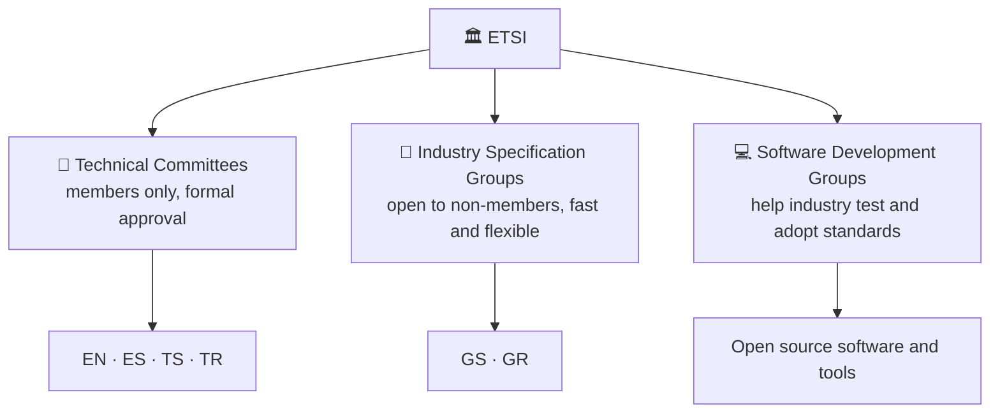
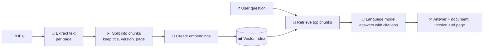
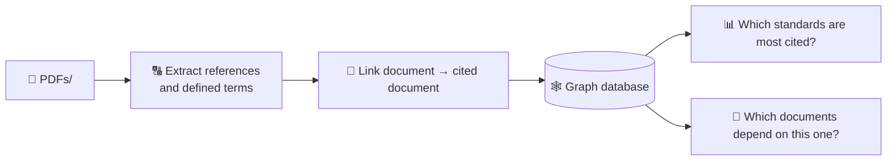

# 📡 ETSI Documentation Library

> A local library of the standards published by **[ETSI](https://www.etsi.org/)**, the European Telecommunications Standards Institute, gathered for **🎓 education** and **🤖 AI research and training**.

All the standard PDFs collected from the ETSI standards search listing live in the **[`PDFs/`](PDFs/)** folder. Entries in the listing that have no published PDF are skipped.

> 🚨 **Before you reuse or redistribute anything here, read [📜 Copyright and licensing](#-copyright-and-licensing).**

---

## 📑 Table of contents

- [📊 At a glance](#-at-a-glance)
- [🏛 About ETSI and how its documents are made](#-about-etsi-and-how-its-documents-are-made)
- [📂 What is inside the folder](#-what-is-inside-the-folder)
- [🔬 Topics covered](#-topics-covered)
- [🔎 Sample data analysis](#-sample-data-analysis)
- [🎯 Use cases](#-use-cases)
- [👥 Who is this for?](#-who-is-this-for)
- [⭐ Spotlight: one standard, many uses](#-spotlight-one-standard-many-uses)
- [🧪 Example workflows](#-example-workflows)
- [📈 Data you can mine](#-data-you-can-mine)
- [✅ Tips for working with the documents](#-tips-for-working-with-the-documents)
- [🚀 Quick start](#-quick-start)
- [🔧 How the collection was built](#-how-the-collection-was-built)
- [📖 Glossary](#-glossary)
- [❓ FAQ](#-faq)
- [📜 Copyright and licensing](#-copyright-and-licensing)
- [🚨 Disclaimer](#-disclaimer)
- [🙏 Attribution](#-attribution)

---

## 📊 At a glance

|                         |                                                                                                                                                                    |
| ----------------------- | ------------------------------------------------------------------------------------------------------------------------------------------------------------------ |
| 🏛️ **Publisher**        | ETSI, a not-for-profit standards body founded in **1988** by CEPT following a proposal from the European Commission; headquartered in **Sophia Antipolis, France** |
| 🌍 **Membership**       | **900+** member organizations from **60+ countries** on five continents: companies, research bodies, universities and public organizations                         |
| 🏢 **SME share**        | Almost **a quarter** of ETSI members are SMEs and micro-enterprises                                                                                                |
| 🇪🇺 **Status**           | One of only **three** bodies officially recognized by the EU as a **European Standards Organization (ESO)**                                                        |
| 🧑‍🔧 **Technical groups** | **45+** Technical Committees, Industry Specification Groups and Software Development Groups                                                                        |
| 🆓 **Access**           | ETSI describes its standards as **freely available**, with more than 60,000 documents                                                                              |
| 📚 **Listing size**     | **67,627** entries in ETSI's standards search listing (checked October 2026)                                                                                       |
| 📄 **Listing layout**   | 50 entries per page, about **1,353 pages**                                                                                                                         |
| 📁 **Format**           | PDF, one file per standard version, stored in `PDFs/`                                                                                                              |
| 🏷️ **File names**       | Original ETSI names, e.g. `gr_ZSM021v010101p.pdf`                                                                                                                  |
| 🗓️ **Recency**          | Includes documents published as recently as 2026                                                                                                                   |

> ℹ️ The number of PDFs on disk can be lower than the listing count, because some listing entries have no downloadable PDF.

---

## 🏛 About ETSI and how its documents are made

ETSI is best known for foundational technologies such as **GSM, TETRA, DECT, 3G, 4G and 5G**, and today it also works on AI security, edge computing, network automation, quantum-safe communication and more. As a European Standards Organization it provides standards and specifications that support EU legislation and public policy, while its work is used worldwide.

### 🧱 Who writes the documents



| Group type                                | Who can take part                                   | What it produces                                                                                    | Typical role                                                                            |
| ----------------------------------------- | --------------------------------------------------- | --------------------------------------------------------------------------------------------------- | --------------------------------------------------------------------------------------- |
| 📘 **Technical Committee (TC)**           | ETSI members                                        | European Standards (EN), ETSI Standards (ES), Technical Specifications (TS), Technical Reports (TR) | Formal standards with structured approval, including those that support regulation      |
| 🧪 **Industry Specification Group (ISG)** | Open to non-members too; steering roles for members | Group Specifications (GS) and Group Reports (GR)                                                    | Quick, focused work on emerging technologies; reports often shape later standards       |
| 💻 **Software Development Group (SDG)**   | Community of developers                             | Software and tools                                                                                  | Practical testing and adoption of ETSI standards (for example Open Source MANO for NFV) |

ETSI also runs interoperability events (**PlugTests**) and has a **Centre for Testing and Interoperability (CTI)** that supports testing work.

### 📈 Milestones worth knowing

| Year | Milestone                                                                             |
| ---- | ------------------------------------------------------------------------------------- |
| 1988 | ETSI founded by CEPT, following a proposal from the European Commission               |
| 2013 | ISG NFV (Network Functions Virtualisation) created in January                         |
| 2026 | ISG NFV holds its 53rd plenary meeting (March), showing how long-running the group is |

---

## 📂 What is inside the folder

```
etsi-org-documentation/
├── 📁 PDFs/        every downloaded ETSI standard, one PDF per version
├── 🐹 main.go      the Go program that builds and refreshes PDFs/
└── 📝 README.md    this file
```

### 🔤 Decoding a file name

Example: **`gr_ZSM021v010101p.pdf`**

| Part      | Meaning                                                            |
| --------- | ------------------------------------------------------------------ |
| `gr`      | Deliverable type: **G**roup **R**eport                             |
| `ZSM`     | Technical body / topic: Zero-touch network and Service Management  |
| `021`     | Document number                                                    |
| `v010101` | Version **1.1.1** (`01` `01` `01`, each part padded to two digits) |
| `p`       | Published PDF                                                      |

### 🗺️ Decoding a path on the ETSI server

ETSI groups its files in predictable folders, which is how the downloader builds each address:

```
https://www.etsi.org/deliver/etsi_gr/ZSM/001_099/021/01.01.01_60/gr_ZSM021v010101p.pdf
                             └──┬──┘ └─┬─┘ └──┬──┘ └┬┘ └───┬────┘
                             type    body  number  doc   version
                                           range   no.   (+ _60 suffix seen on all
                                                          published paths)
```

Documents with larger numbers can use a number range instead of a topic folder, for example
`etsi_en/303600_303699/303645/02.01.01_60/en_303645v020101p.pdf`.

### 🏷️ Deliverable types

| Prefix | Type                    | What it usually is                                                               |
| ------ | ----------------------- | -------------------------------------------------------------------------------- |
| `en`   | European Standard       | Formal standards approved through the European standardization system            |
| `es`   | ETSI Standard           | Documents with technical requirements, approved within ETSI                      |
| `ts`   | Technical Specification | Detailed technical requirements and protocols                                    |
| `tr`   | Technical Report        | Explanatory material and studies                                                 |
| `gs`   | Group Specification     | Requirements or explanatory material produced in an Industry Specification Group |
| `gr`   | Group Report            | Studies, gap analyses and proposals from an Industry Specification Group         |
| `eg`   | ETSI Guide              | Guidance on handling specific technical or procedural matters                    |
| `sr`   | Special Report          | Special-purpose reports                                                          |

---

## 🔬 Topics covered

A sample of what the listing contains, taken from real entries:

| 🧩 Area                                                | 📖 Examples from the listing                                                                                                                                                                                                                                                                                                                                                                       |
| ------------------------------------------------------ | -------------------------------------------------------------------------------------------------------------------------------------------------------------------------------------------------------------------------------------------------------------------------------------------------------------------------------------------------------------------------------------------------- |
| 🤖 **Zero-touch network and Service Management (ZSM)** | GS ZSM 002 _Reference Architecture_ · GS ZSM 009 _Closed-Loop Automation_ (3 parts) · GR ZSM 015 _Network Digital Twin_ · GR ZSM 017 _Closed-Loop Automation Security aspects_ · GR ZSM 020 _Utilization of Agents in Autonomous Networks_ · GR ZSM 021 _From Automation to Autonomy_                                                                                                              |
| 🛡️ **Securing Artificial Intelligence (SAI)**          | GR SAI 001 _AI Threat Ontology_ · GR SAI 002 _Data Supply Chain Security_ · GR SAI 004 _Problem Statement_ · GR SAI 005 _Mitigation Strategy Report_ · GR SAI 006 _The role of hardware in security of AI_ · GR SAI 007 _Explicability and transparency of AI processing_ · GR SAI 011 _Automated Manipulation of Multimedia Identity Representations_ · GR SAI 013 _Proofs of Concepts Framework_ |
| 📶 **Reconfigurable Intelligent Surfaces (RIS)**       | GR RIS 002 _Technological challenges, architecture and impact on standardization_ · GR RIS 003 _Channel Models and Evaluation Methodology_ · GR RIS 004 _Implementation and Practical Considerations_ · GR RIS 007 _Near-field Channel Modeling_ · GS RIS 008 _Standardized Testing_                                                                                                               |
| 🔭 **TeraHertz technology (THz)**                      | GR THz 001 _Use cases_ · GR THz 002 _Frequency bands of interest_ · GR THz 003 _Channel measurements and modeling_ · GR THz 004 _RF Hardware Modeling_                                                                                                                                                                                                                                             |
| 🔌 **Surface Mount Technology (SMT)**                  | GS SMT 001 _Requirements for Embedded Communication Modules for Machine-to-Machine Communications_ (two versions, 2014 and 2015)                                                                                                                                                                                                                                                                   |
| 🧠 **Experiential Networked Intelligence (ENI)**       | Reports on AI-assisted network operation, e.g. GR ENI 051                                                                                                                                                                                                                                                                                                                                          |
| 🏠 **Cyber security for consumer IoT (CYBER)**         | EN 303 645 _Baseline Requirements_ (see the [spotlight](#-spotlight-one-standard-many-uses))                                                                                                                                                                                                                                                                                                       |

### 🧪 Other Industry Specification Groups

ETSI overview material has listed many more ISGs besides the ones above. Names change over time, so check ETSI's site for the current list:

| ISG                                   | Subject                                    |
| ------------------------------------- | ------------------------------------------ |
| **NFV**                               | Network Functions Virtualisation           |
| **MEC**                               | Multi-access Edge Computing                |
| **QKD**                               | Quantum Key Distribution                   |
| **F5G**                               | Fifth Generation Fixed Network             |
| **ISAC**                              | Integrated Sensing and Communications      |
| **PDL**                               | Permissioned Distributed Ledger            |
| **ARF, CDM, CIM, ETI, mWT, NIN, OEU** | Further specialist topics; see ETSI's site |

---

## 🔎 Sample data analysis

To show what the collection looks like, here is an analysis of the **first 50 entries** of ETSI's listing (page 1, fetched October 2026).

> ⚠️ This is **one page, not the whole library**. Page 1 happens to be dominated by a few technical bodies, so treat these numbers as an illustration of the data, not as statistics for all 67,627 entries.

### 🧩 Entries by technical body

| Technical body                                  | Entries |    Share |
| ----------------------------------------------- | ------: | -------: |
| Zero-touch network and Service Management (ZSM) |      26 |      52% |
| Securing Artificial Intelligence (SAI)          |       9 |      18% |
| Reconfigurable Intelligent Surfaces (RIS)       |       9 |      18% |
| TeraHertz technology (THz)                      |       4 |       8% |
| Surface Mount Technology (SMT)                  |       2 |       4% |
| **Total**                                       |  **50** | **100%** |

### 🏷️ Entries by deliverable type

| Type                     | Entries | Share |
| ------------------------ | ------: | ----: |
| Group Report (GR)        |      33 |   66% |
| Group Specification (GS) |      17 |   34% |

### 🗓️ Entries by publication year

| Year | Entries |     | Year      | Entries |
| ---- | ------: | --- | --------- | ------: |
| 2014 |       1 |     | 2022      |       7 |
| 2015 |       1 |     | 2023      |       9 |
| 2018 |       1 |     | 2024      |       8 |
| 2019 |       3 |     | 2025      |       6 |
| 2020 |       3 |     | 2026      |       6 |
| 2021 |       5 |     | **Total** |  **50** |

### 🔍 Other observations from the sample

- 🔁 Several documents appear in more than one version, for example GS ZSM 007 (v1.1.1 in 2019 and v2.1.1 in 2023), GS ZSM 006 (v1.1.1 and v1.2.1), GR ZSM 011 (v1.1.1 and v2.1.1), and GR RIS 002 and 003 (v1.1.1 and v1.2.1). Keep all versions apart when building datasets.
- 🔗 2 of the 50 entries (both in the THz series) list newer versions in the `new_versions` field.
- 🏷️ Keywords are free text, comma separated and capitalized inconsistently (for example _AI_ next to _artificial intelligence_), so normalize them before counting.
- ✍️ Titles contain typos in places (one SAI title spells "Artificial" with a capital I in place of the lowercase l), so use identifiers rather than titles to match documents.
- 📭 Some fields (`ReviewDate`, `Scope`) are empty, so do not rely on them.

---

## 🎯 Use cases

### 🎓 Education and self-study

- 📖 **University courses**: telecom, networking, cybersecurity, IoT and AI-governance modules can point students at the original source documents instead of secondhand summaries.
- 🧑‍🎓 **Theses and literature reviews**: cite primary sources and trace how a technology (for example network digital twins or AI security) was framed over several document versions.
- 🧭 **Self-directed learning**: read the _Group Reports_ first for background, then move on to the _Group Specifications_ and _European Standards_ for the normative detail.
- 🏫 **Teaching how standards work**: use real version histories (v1.1.1 → v1.2.1 → v2.1.1) to show students how standards evolve, are superseded and are revised.
- 📝 **Exam and certification prep**: practice questions and flashcards built from real specification text.
- 🗣️ **Terminology**: dedicated terminology documents (such as GS ZSM 007) are ready-made glossaries for students and technical writers.
- 🧩 **Capstone and lab projects**: pick a reference architecture (for example ZSM) and have students prototype one function from it.

### 🤖 AI and machine learning _(subject to the [licensing notice](#-copyright-and-licensing))_

- 💬 **Retrieval-augmented generation (RAG)**: a "chat with the standards" assistant that answers questions with citations to the exact document and version.
- 🔎 **Semantic search**: embed every document so engineers can search by meaning ("closed-loop automation security") instead of exact keywords.
- 🧠 **Domain adaptation**: fine-tune or evaluate language models on dense telecom and standards language.
- ❓ **Question-answer datasets**: generate and verify Q&A pairs, then use them as a benchmark for how well a model understands standards.
- 🏷️ **Classification and tagging**: train classifiers on the technical body and keyword fields to auto-tag new documents.
- 🧾 **Summarization**: produce short briefs of long specifications for managers and non-specialists.
- 🕸️ **Knowledge graphs**: link documents through the references each one cites, plus the "new version" relationships in the listing.
- 🔠 **Information extraction**: pull out defined terms, abbreviations, requirements ("shall" statements) and reference lists.
- 🧪 **Evaluation sets**: test whether a model can tell a normative requirement ("shall") from a recommendation ("should").
- 🛡️ **AI safety and security research**: the SAI series is itself a rich corpus about AI threats, mitigation and explainability.
- 🌐 **Table and figure understanding**: standards are full of tables, state machines and message-flow diagrams, which makes them a demanding test for document-understanding models.

### 📡 Telecom and network engineering

- 🛠️ **Implementation reference**: keep the exact version of a specification next to your code, even offline or inside an air-gapped lab.
- ✅ **Interoperability and conformance testing**: trace test cases back to the requirements they verify.
- 🏗️ **Architecture work**: reference architectures (for example ZSM) are a starting point for design reviews and vendor evaluations.
- 🔁 **Version comparison**: compare two versions of the same specification to see what changed before upgrading a product.
- 🤝 **Procurement**: cite the exact standard and version in tenders and vendor questionnaires.

### 🔐 Security and AI governance

- 🧱 **Threat modeling**: use the SAI threat ontology and mitigation reports as input to risk assessments of AI systems.
- 🔍 **Gap analysis**: map your internal security policy to the requirements in published ETSI documents.
- 📋 **Audit preparation**: collect the exact documents and versions an audit refers to.
- 🏠 **Product security baselines**: consumer IoT makers can work from EN 303 645 (see the spotlight).

### ⚖️ Policy, regulation and compliance

- 🇪🇺 **EU context**: ETSI produces standards that support European Union legislation and public policy, and several ETSI AI documents refer to the EU AI Act. Lawyers and compliance teams can read the technical side of the rules they work with.
- 🗺️ **Policy research**: study how technical standards shape regulation, spectrum use and market access.
- 📑 **Regulatory mapping**: match legal obligations to the technical documents that are commonly used to meet them.

### 🔬 Research and innovation

- 🚀 **Emerging technology scouting**: THz, RIS, digital twins and autonomous networks give an early view of research that may feed future generations of networks.
- 📉 **Bibliometrics and trend analysis**: count publications by topic and year to see which technologies are gaining or losing momentum.
- 🤝 **Academic–industry bridging**: see which problems industry groups consider important enough to write down as requirements.
- 📚 **Related-work sections**: ground papers in the standards that practitioners actually use.

### 🏭 IoT, M2M and industry

- 🔌 **Device and module design**: requirements for embedded communication modules in machine-to-machine systems (SMT series).
- 🏢 **Product planning**: check which standards your sector already depends on before starting a new product line.
- 🧰 **Startup research**: understand the standards landscape around a new product before investing in a design.

### 📚 Libraries and archives

- 🗄️ **Offline reference library** for universities, labs and companies with restricted internet access.
- 🕰️ **Historical record**: a snapshot of what was published when, useful when a website reorganizes or a document is withdrawn.

### 📈 Data analysis

- 📊 **Publication trends** by year, document type and technical body.
- 🔗 **Version chains**: follow documents from first release to current version.
- 🏷️ **Keyword statistics**: find the most used terms per technology area.

### ✍️ Technical writing and translation

- 📝 **Consistent wording**: reuse the exact terms and definitions from the standards in manuals and documentation.
- 🌐 **Localization teams**: align translated glossaries with the official English source terminology.

---

## 👥 Who is this for?

| 👤 You are...                      | 🎁 What you get                                                  | 🚦 Good starting point                                               |
| ---------------------------------- | ---------------------------------------------------------------- | -------------------------------------------------------------------- |
| 🎓 A student                       | Primary sources for coursework and theses                        | Group Reports (`gr_*`) on a topic you study                          |
| 🧑‍🏫 A teacher                       | Real documents and version histories for classroom use           | ZSM or SAI series, which are well structured                         |
| 🧑‍💻 A developer or network engineer | Offline, version-pinned specifications                           | The Group Specification or Technical Specification for your protocol |
| 🔐 A security professional         | Threat and mitigation material                                   | SAI series; EN 303 645 for consumer IoT                              |
| ⚖️ A lawyer or compliance officer  | The technical text behind regulation                             | European Standards (`en_*`) and AI-related reports                   |
| 🔬 A researcher                    | A corpus for surveys and trend analysis                          | THz, RIS, ENI and ZSM reports                                        |
| 🤖 An ML engineer                  | A large, structured technical text corpus (see licensing notice) | Chunk by clause, keep version metadata                               |
| 📚 A librarian or archivist        | An organized offline collection                                  | `PDFs/` plus the metadata fields below                               |

---

## ⭐ Spotlight: one standard, many uses

**ETSI EN 303 645, _Cyber Security for Consumer Internet of Things: Baseline Requirements_** shows how a single document serves many audiences.

| Fact                    | Detail                                                                                                                                                                                               |
| ----------------------- | ---------------------------------------------------------------------------------------------------------------------------------------------------------------------------------------------------- |
| 🏭 **Produced by**      | ETSI Technical Committee CYBER                                                                                                                                                                       |
| 🗓️ **Versions**         | V2.1.1 (June 2020), V3.1.3 (September 2024)                                                                                                                                                          |
| 📏 **Content (V2.1.1)** | 13 cyber security provisions plus 5 data-protection provisions                                                                                                                                       |
| 🧸 **Devices in scope** | Connected toys and baby monitors, smoke detectors and door locks, smart cameras, TVs and speakers, wearable health trackers, home automation and alarms, connected appliances, smart home assistants |
| 🧪 **Assessment**       | Conformance can be assessed through ETSI TS 103 701                                                                                                                                                  |
| 🌏 **Reach**            | Referenced by national consumer IoT codes and labeling schemes                                                                                                                                       |

| 🎯 Audience         | 💡 How they use it                                                                                              |
| ------------------- | --------------------------------------------------------------------------------------------------------------- |
| 🧑‍💻 Product teams    | Design checklist: for example no universal default passwords, a way to report vulnerabilities, software updates |
| 🔐 Security testers | Test plans mapped to each provision                                                                             |
| ⚖️ Compliance teams | Cross-mapping to other frameworks and national rules                                                            |
| 🎓 Students         | A readable example of a real security standard                                                                  |
| 🤖 ML engineers     | A good test document for extracting "shall" requirements, and for comparing V2.1.1 with V3.1.3                  |

---

## 🧪 Example workflows

### 🔄 Build a "chat with the standards" assistant



### 🕸️ Build a standards knowledge graph



### 💡 Dataset ideas

| 💡 Idea                 | 📥 Input                               | 📤 Output                           | 🎚️ Difficulty |
| ----------------------- | -------------------------------------- | ----------------------------------- | :-----------: |
| Abbreviation dictionary | Abbreviation sections of each document | Term → meaning table                |    🟢 Easy    |
| Topic classifier        | Title, keywords, technical body        | Predicted topic area                |    🟢 Easy    |
| Standards Q&A benchmark | Paragraphs from the PDFs               | Verified question and answer pairs  |   🟡 Medium   |
| Requirement extractor   | Normative text containing "shall"      | A structured list of requirements   |   🟡 Medium   |
| Citation graph          | Reference lists                        | Which standards depend on which     |   🟡 Medium   |
| Version diff summarizer | Two versions of the same document      | Plain-language list of changes      |    🔴 Hard    |
| Figure and table reader | Diagrams and tables                    | Structured data or text description |    🔴 Hard    |

---

## 📈 Data you can mine

Each PDF can be matched with metadata from ETSI's listing, which makes the collection easy to analyze:

| 🏷️ Field                                    | 📝 What it tells you                                                                        |
| ------------------------------------------- | ------------------------------------------------------------------------------------------- |
| `ETSI_DELIVERABLE`                          | Full name and version, e.g. _ETSI GR ZSM 021 V1.1.1 (2026-05)_, including publication month |
| `TITLE`                                     | Human-readable title                                                                        |
| `TB`                                        | Technical body responsible for the work                                                     |
| `Keywords`                                  | Subject keywords (for example _automation_, _closed control loop_, _digital twins_)         |
| `STATUS_CODE` / `ACTION_TYPE`               | Where the document is in the ETSI process (all sampled entries were published)              |
| `IsCurrent` / `superseded` / `new_versions` | Hints about newer versions; check them before relying on them                               |
| `WKI_REFERENCE`                             | ETSI's internal work-item reference, e.g. `DGR/ZSM-021_GRAutom2Auton`                       |
| `wki_id`                                    | Unique work-item number, a good key for deduplication                                       |
| `EDSpathname` / `EDSPDFfilename`            | Where the file lives on the ETSI server                                                     |

---

## ✅ Tips for working with the documents

| 🧭 Topic                   | 💡 Advice                                                                                                                                                                                                           |
| -------------------------- | ------------------------------------------------------------------------------------------------------------------------------------------------------------------------------------------------------------------- |
| 🔁 **Versions**            | The same standard often exists in several versions. Store the version with every chunk, and prefer the newest one unless you study history.                                                                         |
| 🧱 **Structure**           | Documents follow a common layout: front matter, copyright notice, intellectual property section, scope, references, definitions, main clauses, annexes, history. Strip the boilerplate before training or indexing. |
| 🔤 **Normative words**     | "Shall" means a requirement, "should" a recommendation, "may" an option. Keep them intact when you chunk text.                                                                                                      |
| 📐 **Tables and figures**  | Plain text extraction can scramble tables and drop diagrams. Check a few pages by eye.                                                                                                                              |
| 🧹 **Headers and footers** | Every page repeats the document name and version. Remove them so they do not pollute embeddings.                                                                                                                    |
| 🔑 **Identifiers**         | Match documents by `wki_id` or the full deliverable name, not by title, because titles repeat across versions.                                                                                                      |
| 📅 **Freshness**           | Standards get revised and withdrawn. Re-run the downloader regularly and compare against ETSI's site.                                                                                                               |

---

## 🚀 Quick start

```bash
# how many PDFs do you have?
ls PDFs | wc -l

# find everything from one technical body (e.g. ZSM)
ls PDFs | grep -i zsm

# turn a PDF into plain text (needs poppler-utils)
pdftotext -layout PDFs/gr_ZSM021v010101p.pdf -

# search all PDFs for a phrase (needs ripgrep-all, or loop with pdftotext)
rga "closed-loop" PDFs/
```

---

## 🔧 How the collection was built

A small Go program (`main.go`, standard library only) pages through ETSI's public standards listing and saves every PDF into `PDFs/`:

- 🔗 PDF address = `https://www.etsi.org/deliver/` + folder path + file name
- ⏭️ Files that already exist are skipped, so a run can be stopped and resumed
- 🛡️ Downloads are checked to be real PDFs and written safely, so partial files are never mistaken for finished ones
- 🐢 Requests are spaced out, retried politely, and stopped if the server starts rate limiting
- 📜 Every page visited and action taken is logged

To refresh the collection:

```bash
git clone https://github.com/PrajwalKoirala638/etsi-org-documentation.git
cd etsi-org-documentation
go run main.go
```

---

## 📖 Glossary

| Term                                      | Meaning                                                                                         |
| ----------------------------------------- | ----------------------------------------------------------------------------------------------- |
| **ETSI**                                  | European Telecommunications Standards Institute                                                 |
| **ESO**                                   | European Standards Organization, a body officially recognized by the EU                         |
| **CEPT**                                  | European Conference of Postal and Telecommunications Administrations, which set ETSI up in 1988 |
| **TC**                                    | Technical Committee                                                                             |
| **ISG**                                   | Industry Specification Group                                                                    |
| **SDG**                                   | Software Development Group                                                                      |
| **EN / ES / TS / TR / GS / GR / EG / SR** | Deliverable types (see the table above)                                                         |
| **NFV**                                   | Network Functions Virtualisation                                                                |
| **MEC**                                   | Multi-access Edge Computing                                                                     |
| **ZSM**                                   | Zero-touch network and Service Management                                                       |
| **SAI**                                   | Securing Artificial Intelligence                                                                |
| **ENI**                                   | Experiential Networked Intelligence                                                             |
| **RIS**                                   | Reconfigurable Intelligent Surface                                                              |
| **THz**                                   | TeraHertz                                                                                       |
| **QKD**                                   | Quantum Key Distribution                                                                        |
| **SMT**                                   | Surface Mount Technology                                                                        |
| **M2M / IoT**                             | Machine-to-Machine / Internet of Things                                                         |
| **RAG**                                   | Retrieval-augmented generation                                                                  |
| **PlugTest**                              | ETSI interoperability testing event                                                             |

---

## ❓ FAQ

**🤔 Are these the official documents?**
They are copies downloaded from ETSI's public site. For the authoritative, current version always check the [ETSI website](https://www.etsi.org/standards).

**🤖 Can I train an AI model on them?**
ETSI keeps the copyright, and downloading for reading does not by itself answer that question. Read the [licensing section](#-copyright-and-licensing) and, if in doubt, ask ETSI.

**🔄 How up to date is the collection?**
It reflects the day the downloader was last run. New and revised documents appear on ETSI's site all the time, so rerun the downloader to refresh.

**📭 Why are some listing entries missing from `PDFs/`?**
Some entries have no published PDF, and the downloader skips them.

**🧑‍⚖️ Is this affiliated with ETSI?**
No. This is an independent collection.

---

## 📜 Copyright and licensing

**🔒 The PDFs in this repository are not the work of this repository's author.** ETSI owns the copyright in its standards and reserves all rights.

- 📜 ETSI's published documents carry a notice that no part may be reproduced or used in any form or by any means without written permission from ETSI, and that the PDF content must not be modified without ETSI's written authorization.
- 🌐 ETSI makes its standards publicly available to **read and download**, but that does not by itself grant permission to **redistribute** them or to use them for every purpose, **including training AI models**.
- ✉️ ETSI states that reproduction of ETSI material may be allowed on request through its copyright licence request form, and its website terms direct reproduction inquiries to ETSI Legal Services.

✅ **What this means for you:** before redistributing these files, or using them to train or fine-tune an AI model, make sure your use is permitted by ETSI's terms and by the law that applies to you. If it is unclear, ask ETSI.

🔗 Useful ETSI pages:

- 📄 Terms of Use: <https://www.etsi.org/terms/>
- 📝 Intellectual Property Rights and the copyright licence request form: <https://www.etsi.org/resources/intellectual-property-rights/>

💻 The Go source code in this repository is the work of the repository author. The ETSI documents in `PDFs/` remain the property of ETSI and are covered by ETSI's terms, not by the licence of the code.

---

## 🚨 Disclaimer

- 🚫 This repository is **not affiliated with, endorsed by, or sponsored by ETSI**.
- 🔄 Standards are revised and withdrawn over time. For the authoritative, current version of any document, use the [ETSI website](https://www.etsi.org/standards).
- 📦 Documents are provided as downloaded, unmodified, and without warranty of any kind.
- 📬 If you are a rights holder and want something removed, please open an issue and it will be handled promptly.

---

## 🙏 Attribution

Every PDF in this collection is **© ETSI**. Please credit ETSI as the source whenever you quote or cite the documents.
